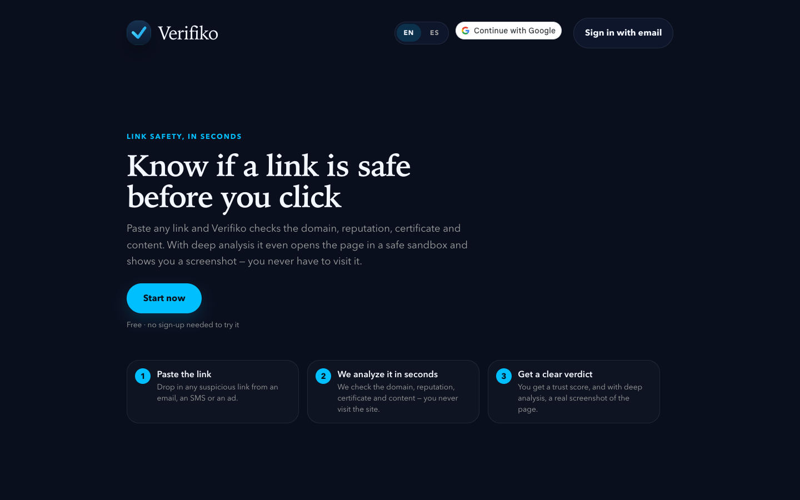
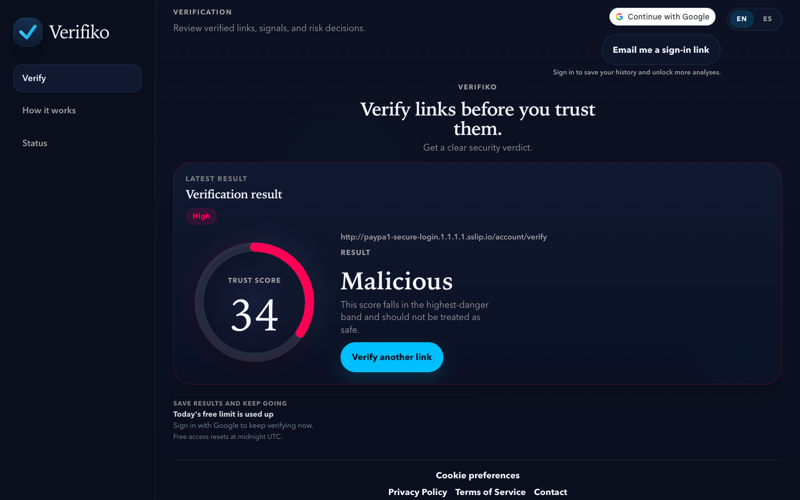

# Verifiko

**Is this link safe?** Verifiko detects phishing and malware links. You paste a URL and get an
explainable verdict in seconds. The same engine is available to developers through a versioned
REST API. It is built as a direct alternative to tools like URLert.

[](LICENSE)
<!-- CI badge goes here once the test workflow exists. -->

**Live:** https://www.verifiko.es · **API:** `https://api.verifiko.es/api/v1` ([reference](docs/API.md))

| Landing | Verdict |
|---|---|
|  |  |

## What it does

Each verification produces a **trust score** (0–100), a **risk level** (`SAFE` → `CRITICAL`) and
the list of signals that led to it. Every signal has a severity, a confidence and an EN/ES
explanation, so the verdict can be audited instead of trusted blindly.

**Detection engine**
- **Deterministic heuristics** across about 30 signal types. On the URL: IP-address hosts, Unicode
  homographs, zero-width characters, deceptive brand subdomains, high-entropy domains, risky TLDs and
  shorteners. On the page and transport: credential-harvest forms, login-surface lures, TLS failures
  and hostname mismatches, suspicious redirect chains, and domain registration age (RDAP).
- **Brand typosquatting** (`paypa1.com`, `g00gle.com`) detected through leetspeak normalization plus
  edit distance.
- **Reputation aggregation** across URLhaus and OpenPhish. A **2-of-N consensus** rule keeps one
  noisy feed from deciding a verdict, and each provider sits behind a **circuit breaker**.
- **Weighted scoring policy** plus **compound rules**, which escalate combinations of signals and
  decisive standalone signals.
- **Wave-based orchestration**: network-bound analyzers run in dependency-ordered waves, and
  reputation, domain-age and infrastructure lookups are cached in Redis. A **fail-fast** path skips
  the network waves when the URL alone is already `HIGH`/`CRITICAL`.

**Product and API**
- Public web app: anonymous checks with daily quotas. Accounts sign in with **Google**, an
  **email magic link**, or email + password.
- Developer **API keys** and the versioned **`/api/v1`** surface, with per-plan daily quotas and
  burst rate limits.
- **Async scan pipeline**: `POST /scans` (or `/scans/batch`) → `202`, then poll `GET /scans/{id}` or
  receive a signed **webhook**. Jobs live in Postgres. Dispatch runs either in-process or through a
  queue (Upstash QStash) for serverless runtimes.
- **Deep scan** (signed-in users, async only, behind a feature flag): the URL is detonated in a
  headless browser (Browserless). Behavioral signals feed into scoring before the verdict: a rendered
  credential form, an off-site form action, a JS redirect off-site, a drive-by download. A screenshot
  is stored in Cloudflare R2 and served via a short-lived presigned URL.
- EN/ES throughout: UI, verdicts and API error messages.

**Roadmap (not built yet)**
- Calibrating detection weights against a detonation-specific corpus.
- Computer vision over deep-scan screenshots: brand-logo matching, visual fake-login detection.
- Usage-based billing (credits), a domain-classification product, a public threat feed, a browser
  extension.
- Frontend tests and CI.

## Architecture

```text
   Browser (React SPA)              API clients (X-API-Key)
   www.verifiko.es                           │
          └───────────────┬──────────────────┘
                          ▼
             FastAPI  ·  /api/v1  ·  api.verifiko.es
  ┌──────────────────────────────────────────────────────────┐
  │ entrypoints     routes, schemas, DI container            │
  │ application     use cases, signal analyzers, ports       │
  │ domain          entities, scoring policy, compound rules │
  │ infrastructure  adapters behind the ports ↓              │
  └──────────────────────────────────────────────────────────┘
   Postgres (Neon)   Redis (Upstash)   URLhaus · OpenPhish · RDAP
   SQLAlchemy +      limiters, caches  HTML / TLS / DNS fetchers
   Alembic                             (SSRF-guarded, IP-pinned)
   Browserless · Cloudflare R2 · Resend · QStash   (optional)
```

- **Backend** (`api/`): Python 3.11, FastAPI, and **Clean Architecture** with strict layering.
  The domain does no I/O. Application code depends only on ports. Infrastructure adapters are wired
  in one dependency-injection container (`app/entrypoints/api/dependencies/container.py`).
  Postgres is reached through SQLAlchemy and psycopg v3, with Alembic migrations.
- **Frontend** (`web/`): React 18, TypeScript and Vite, with React Router and EN/ES i18n. The
  landing is server-rendered at build time (prerendered). PWA support (service worker + install
  prompt) is behind a build flag.
- **Deploy**: two Vercel projects, the API (`api/index.py`) and the static frontend. Schema
  migrations run from a GitHub Action whenever a migration lands on `main`, separately from the
  code deploy (see [`api/DEPLOY.md`](api/DEPLOY.md)).

Risky capabilities ship **behind feature flags that are off by default**: deep scan, screenshot
storage, the fail-fast path, the OpenPhish feed and queue dispatch. New capabilities therefore land
dark until they are explicitly enabled.

## Security highlights

- **SSRF guard on every outbound fetch to user-controlled destinations**: verification targets,
  redirects, HTML/TLS/DNS lookups and webhook URLs. The guard allows only `http`/`https`, rejects
  internal hostnames, resolves DNS, and blocks the request unless **every** resolved address is
  globally routable. That includes IPv4 addresses embedded in IPv6: IPv4-mapped, 6to4, Teredo,
  NAT64 and IPv4-compatible. Adapters then connect only to the **validated, pinned IP**, which closes
  DNS-rebinding/TOCTOU and redirect-follow bypasses.
- **Fails closed in production**: the API refuses to start if a signing secret is unset, blank, or
  still its development default.
- **Signed webhooks**: HMAC-SHA256 over `timestamp.body`, sent as `X-Verifiko-Signature`. See
  [verification](docs/API.md#verifying-the-signature).
- **Authenticated internal worker**: queue callbacks must carry a valid QStash JWT (HS256, with
  current/next key rotation).
- **Credentials at rest**: passwords are hashed with Argon2. API keys are stored only as SHA-256
  hashes and shown once.
- **Client IP for quotas** comes from `X-Forwarded-For` only when the request arrives from a
  configured trusted proxy.

## Running locally

Requirements: Python 3.11, Node.js 18+, and Docker (for the local Postgres).

**API**

```bash
cd api
python -m venv .venv && source .venv/bin/activate
pip install -e ".[dev]"
cp .env.example .env          # local-dev defaults; every variable is documented inline
docker compose up -d db
alembic upgrade head
uvicorn app.entrypoints.api.main:app --reload --port 8000
```

`api/.env.example` lists every setting by name. Without extra configuration you get a working
local API using Postgres only. Redis, Google Sign-In (`GOOGLE_CLIENT_ID`), email
(`RESEND_API_KEY`), deep scan (`DETONATION_ENABLED`, `BROWSERLESS_ENDPOINT`) and screenshot storage
(`SCREENSHOT_STORAGE_ENABLED`, `R2_*`) are optional. In production `AUTH_TOKEN_SECRET` and
`SCAN_WEBHOOK_SIGNING_SECRET` are required.

**Web**

```bash
cd web
npm ci
npm run dev                   # http://localhost:5173, talks to http://localhost:8000
```

In development the app targets `http://localhost:8000` when `VITE_API_BASE_URL` is unset. Copy
`web/.env.example` to `.env` only if you need to set `VITE_GOOGLE_CLIENT_ID`, and in that case
set `VITE_API_BASE_URL=http://localhost:8000` too.

## Testing

```bash
cd api
python -m pytest -q                      # ~500 unit + integration tests
python -m evaluation.run_evaluation      # detection-quality harness
```

The evaluation harness scores the engine offline against a labeled corpus of malicious and benign
URLs. At the `MEDIUM` threshold the current baseline is **precision 1.00, recall 0.82, false
positive rate 0.00**. Changes must not regress precision.

Frontend: `cd web && npm run build` type-checks (`tsc --noEmit`), builds and prerenders. There
are no frontend unit tests or CI yet. Both are on the roadmap.

## Spec-driven changes

Behavior changes go through [OpenSpec](https://github.com/Fission-AI/OpenSpec). Each one starts as
a proposal with a spec delta, design and tasks under `openspec/changes/`, and once merged it is
archived into living capability specs under [`openspec/specs/`](openspec/specs/). Examples include
the outbound fetch guard and the production config safety rules. Pure refactors, docs and
dependency hygiene skip it.

## Repository layout

```text
api/          FastAPI service (app/{domain,application,infrastructure,entrypoints}), tests, evaluation
web/          React + Vite + TypeScript app
docs/         API reference and design docs (headless detonation, R2 screenshots, PWA)
openspec/     Capability specs and archived change proposals
screenshots/  Images used in this README
```

## License

[Apache License 2.0](LICENSE) © 2026 Hernán Bonavota
